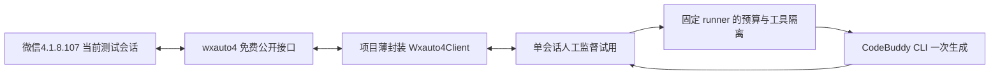

# wxauto4 最小文字收发与模型接入计划

返回[PROGRESS](../PROGRESS.md) / [TASKS](../TASKS.md) / [本任务交接](../tracks/tasks/WX-WXAUTO4-PLAN/HANDOFF.md) / [medium指令](IMPLEMENTATION_GUIDE.md)。2026-10-27，Asia/Shanghai；session `WX-WXAUTO4-PLAN-20261027`。本文是后续实施依据，本轮只交付文档。

## 1. 要做成什么

先让一个操作者指定并打开的微信会话能收到新测试文字、发出一条测试文字；成立后再让CodeBuddy回复一条新测试文字。选择 **wxauto4免费版41.1.7＋微信4.1.8.107＋现有独立CodeBuddy runner**。用户当前微信4.1.15.13，已接受换版，不再询问是否愿意更换；实际更换和登录尚未进行。

首轮采用前台、人工监督、单会话模式，优先使用专门的亲友测试群，也允许用户明确指定一个测试私聊。它不是后台多群机器人。免费版能否满足本机实际需求由一次小试验回答，不先做图片、真实@、free参与、成员管理、长期记忆、表情、网页、开机自启或24h运行。上述能力延期，不成为改写上游核心的理由。

本轮不安装包或客户端、不登录、不读微信UI/数据库、不收发消息、不调用模型、不改业务代码。下列三项实施任务均为 **planned、未领取**；用户选medium并发出对应指令后，才执行那一项，结束即停。

## 2. 架构决定与现有代码的关系



WX-WXA-01/02只到“试用”，模型调用数为0；WX-WXA-03才接图中模型路径。试用层负责当前会话复核、新旧消息区分、单次动作计数和结果记录，不重做微信登录、协议、缓存、心跳或恢复。界面操作交给框架的公开方法，不另写键鼠收发器。

本次决定暂不加入AstrBot：当前微信仓库已经有独立Python调用层，wxauto4是本地Python公开接口；额外做OneBot转换或借用QQ的AstrBot实例会增加接点，不能帮助首次验证收发。后续确有插件需求再评估，不为复用名字而伪造QQ数字身份。

现有`NormalizedEvent`、`Gate`、`Capabilities`、`Router`仍是离线核心：事件只接受mock/pyweixin，Gate拒绝真实通道，`production_eligible`恒false，`ModelFacade`默认只接受离线替身。这些是实际代码状态，不是改一个transport开关就能接通。首期试用使用独立、明确命名的`TrialBinding`/`TrialMessage`，不把UI昵称或临时ID包装成生产事件，不将能力位强设true。默认五份配置和旧离线路径保持可用。

模型阶段复用本项目已经固定的`InputBudget`、`create_runner`、纯文本过滤、工具/MCP隔离与清理逻辑，增设显式真实CLI入口；不重新抄一套模型客户端、不修改QQ或上游框架。暂不接Ollama真实执行；其现有离线能力保留。

## 3. 2026-10-27公开依据与待实测项

| 项目 | 当前依据 | 实施含义 |
| --- | --- | --- |
| 环境与配套 | [官方安装页](https://docs.wxauto.org/docs/install.html)：Windows UI Automation；免费版兼容说明到4.1.8.107，支持本项目Python3.12 | 不在现用4.1.15.13上调选择器/改框架；换版后实测，不能承诺一定兼容或不掉线 |
| 包工件 | [PyPI 41.1.7](https://pypi.org/project/wxauto4/41.1.7/)及其公开JSON元数据：CPython3.12 Windows x64 wheel，2026-09-01发布 | 固定分发物和依赖，不自动追latest；当前只读元数据，未下载/导入 |
| 当前窗口接口 | [Chat类](https://docs.wxauto.org/docs/class/Chat.html)：`ChatInfo()`、`GetAllMessage()`、`SendMsg()`，无Plus标记 | 首期只用这三个业务方法；读取的是当前会话消息，不承诺后台监听 |
| 搜索与后台能力 | [WeChat类](https://docs.wxauto.org/docs/class/WeChat.html)：`ChatWith(exact=True)`/`GetSession`可用；`AddListenChat`/`GetNextNewMessage`等标Plus | 首试由用户手动打开会话，不搜索联系人或枚举会话；不调用Plus或自动购买 |
| 消息含义 | [Message类](https://docs.wxauto.org/docs/class/Message.html)：`attr`区分self/friend/system；`type`含text；`id`切换UI后会变，`sender`为显示名，hash带Plus标记 | 只用普通公开属性，不依赖Plus消息子类/hash；ID仅在本次UI周期去重，sender不宣称稳定身份 |
| 发送结果 | Chat文档将返回值称为`WxResponse`，未给出微信服务端回执合同 | 固定包中核对公开返回形态；记录本地返回和人工观察，不按对象truthiness宣称送达 |
| 客户端下载线索 | 安装页指向[SiverKing对应Release](https://github.com/SiverKing/wechat4.0-windows-versions/releases/tag/v4.1.8.107)，发布2026-04-14 | 是第三方版本归档，不冒充腾讯官方分发；实施时先核版本/签名，再安装 |

固定wheel：`wxauto4-41.1.7-cp312-cp312-win_amd64.whl`，2,946,186字节，PyPI SHA-256：`096a365ba71060c1af3c1f096342d5a16609452f51bcaf46e7359dd54235ebbf`。PyPI列出colorama/comtypes/httpx/pillow/psutil/pyperclip/pywin32/tenacity；这不是已核依赖版本集合，实际精确版本由实施时项目uv锁记录。元数据license字段为空；只记录包内实际许可/条款位置，不据空字段推导无法个人试用，也不把免费等同允许再分发。

客户端Release当前asset为`weixin_4.1.8.107.exe`，233,506,664字节；GitHub提供摘要`b79aa3fdfd208d64f38fcc354684f9af213c05993c6f603521f2813930362b90`。摘要只能证明与该归档工件一致；本轮未下载、未检查Authenticode。后续以下载字节、Windows签名状态/发布者和文件版本核实，签名无效或版本不符则不运行该安装包；不以修改文件/绕过校验解决。

官方文档跨免费/Plus共用，不保证每个新文档参数都在固定免费包存在。WX-WXA-01先核固定包公开签名/属性和返回值，保留`api_contract_unverified`差额；WX-WXA-02再观察本机行为。不要求解析私有二进制、反汇编或追查全部内部机制。

## 4. 首次试用的接口与行为

### 4.1 最少文件和项目接口

拟新增两份运行模块：`src/wechatbot/transports/wxauto4_adapter.py`只封装公开API，`src/wechatbot/wxauto4_trial.py`包含试用数据、状态和独立CLI。小辅助函数优先留在这两处，不为一次试验另建服务、网络端口、插件系统或通用消息总线。

| 项目侧接口（拟定） | 行为 | 是否操作微信 |
| --- | --- | --- |
| `inspect_dependency()` | 用分发元数据/工件清单报告版本，不import wxauto4，不创建WeChat对象 | 否 |
| `Wxauto4Client(factory)` | 依赖工厂注入；仅显式live运行才从wxauto4加载WeChat | 默认否 |
| `current_chat()` | 调用ChatInfo，只投影chat_name/chat_type；核对已指定目标 | live才是 |
| `snapshot()` | 调用GetAllMessage，提取公共id/attr/type/sender/content，不调用消息附带操作 | live才是 |
| `send_once(text)` | 目标复核后恰好调用一次SendMsg(msg=text)，不传who，不重新搜索，不加at | live才是 |
| `run_trial(binding, limits)` | 管理基线、测试输入、一次发送及状态；mock用同一流程与注入时钟 | 由显式mode决定 |

`TrialBinding`持有本地测试编号、操作者账号别名（非wxid）、准确会话显示名、类型group/friend、指定测试发送者显示名及试用黑名单。真实绑定只存`secrets/wxauto4-trial.local.json`，仓库只放合成示例。`TrialMessage`持有本次epoch、UI临时id、来源属性、类型、显示名和RAM内测试正文；不提供`server_stable`、可信@或稳定用户ID字段。

试用输出采用`dependency_present`、`chat_match`、`baseline_count`、`new_test_received`、`send_invoked`、`framework_reported_success`、`operator_observed`、`outcome_unknown`等封闭字段。`production_eligible=false`始终保留。不得输出`msg.raw`/完整info/异常repr、聊天名、发送者、正文或CLI认证信息。

### 4.2 获取一条新消息

1. 操作者已登录配套微信，手动打开目标专用会话，测试期间保留在该会话，不同时用电脑切聊天或发送。首试不调用ChatWith、GetSession、GetMyInfo或任何联系人/数据库接口。
2. 显式live才构造WeChat；优先采用固定包支持的公开`resize=False, debug=False`，若参数合同不同则记录并使用已核公开初始化方式，不修改选择器/内部类。框架可能使用焦点、剪贴板及界面操作，应在真实任务说明中包含这些动作；项目不额外读写剪贴板或设置全局选项。
3. ChatInfo的名称/类型与绑定一致后，第一次GetAllMessage建立UI ID基线。**它会取得当前已加载消息，可能含已有文本**；仅在RAM中提取基线ID，不打印、保存或交模型，不滚动拉旧记录。若不接受读取已有内容，先由操作者选一个干净测试会话；项目不自动删除/清空聊天。
4. 首次完成基线后，约定亲友或操作者控制的另一个测试账号（非机器人本人）发送一条自造挑战文本，如`WX-IN-<本次随机串> 你好`。每2秒至多检查一次当前会话，轮询预算最多120秒、至多10条候选新文本；达到任一上限即停。只处理`type=text`、来自指定测试者且不在试用黑名单、非self/system的新ID，并且正文精确符合本次挑战文本。
5. 每轮先核当前会话，读取后再核；重复UI ID不重复消费，同文不同ID不冒充同一消息。本次随机串只用来筛选约定测试材料，不当消息身份、真实@、通用自动触发或去重替代。
6. 目标变化、窗口/UI不可用、整体ID重建/基线无法衔接或账号可能切换时结束本次试验，不自动重新绑定或追赶积压；重开后重新建立基线，旧消息不重放。只有显示名而无法区分同名测试者时，不选第一个，报告需要操作者辨别。

UI临时ID可能无法做到跨切换/重启可靠去重，首轮通过“只消费一个新挑战样本、会话全程人工保持、变化即停”缩小范围。120秒是轮询预算，不能据此声称已能强制中断阻塞的第三方调用；API卡住则由操作者停止本试用进程，记录未完成，不结束微信进程。

文件传输助手可另作发送自检，但其多端同步/自己消息不能替代“亲友发来新消息”的接收验收。默认不把self消息放开成机器人输入，也不据一次自发自收声称亲友群已通。

### 4.3 发一条文字及保留结果

发送前再次核对ChatInfo，保持用户手动打开的当前会话，调用`SendMsg(msg=...)`一次，不用who搜索、不调用msg.reply/quote，不另加Enter、补发或拆成多气泡。自造出站文字包含本次唯一测试串，最多500字符；模型阶段也限制为一条≤500字符的自然纯文本，超出则本次不发，不偷偷截成多条。

目标核对和UI提交不是原子操作，无法防止操作者在两者之间切窗；这是前台试用的明确限制。试用时不操作其他会话，不能把header匹配当作账户/会话服务端认证。发现错误目标立即停后续动作，不自动撤回、补偿或发送解释消息。

独立试用台账放`state/wxauto4-trials/`：单owner锁、每个试用编号一个小型原子写入JSON，记录阶段、计数、attempt与ACK等级，不存正文/真实姓名。内部用于阻止重复的绑定信息仅保存在项目忽略文件，展示用每次随机代号，不把可枚举昵称的无盐hash发到日志。不要复用生产Store的accepted→历史写入来伪装试用通过。

| 过程状态/证据等级 | 含义 | 后续动作 |
| --- | --- | --- |
| prepared | 发送意图已落盘，尚未进入框架调用 | 进程中断后保留为不确定，不启动恢复发送 |
| submitted | 即将调用或已经调用SendMsg，可能已产生外部效果 | 消耗唯一发送次数；异常/取消也不自动再调 |
| local_reported | 已按固定包明确字段读取其成功声明 | 只代表框架报告；不当服务端接受或对端到达 |
| operator_observed | 操作者看到正确会话中的测试串或对端反馈 | 记录人工观察层级；不升级为server_accepted |
| failed_before_submit | 确定未调用SendMsg，例如目标不符 | 本次结束，不由程序自动重试 |
| unknown | 已提交但无法确认、返回形态不明、发送超时/中断 | 保留记录并停止；重启不重放、换trial编号也不自动解锁 |

过程状态与确认等级分开存：`local_reported`只是框架返回证据，不能单独把submitted当已完成；人工确认正确会话中已看到后可记`completed_observed`，ACK仍是operator_observed，不需要伪造服务端ACK。退出时仍未观察到结果则保留unknown。下一次显式运行先检查本项目未决记录；已有prepared/submitted/unknown则拒绝新的真实动作，先由操作者检查实际界面结果。需要人工记观察结论时只更新该attempt的证据，不删除记录、不重新发送；确认等级不足仍保留unknown。此次不建设通用清账器或重试服务。普通WxResponse拒绝不能证明未产生外部效果时也归unknown，不能仅因bool假就宣称绝对没发。

“一次发送”指项目只调用一次上游公开发送方法。包内部是否含重试不能只凭依赖tenacity推断；若其公开配置能关闭发送重试则关闭，若观察到重复或无法满足本次单次试验则记录并停止，不patch内部。服务端ACK、昵称和UI ID的限制不自动否决本次人工监督试用。

## 5. 三个独立实施任务

| 任务 | 交付 | 本任务允许的实际操作 | 结束点 |
| --- | --- | --- | --- |
| WX-WXA-01 最小试用工具 | 两个模块、可选依赖锁/工件清单、合成绑定示例、有意义的离线测试、操作说明 | 仅本项目Python环境包准备及离线运行；0微信构造/窗口/发送/模型 | inspect/mock通过、下一条真实指令可执行，提交后停止 |
| WX-WXA-02 配套客户端与文字试用 | 版本/签名核对、兼容结果、一个目标会话新文本接收及一条自造发送结果 | 用户另发本项指令时允许客户端准备；登录由操作者完成；仅指定会话、≤120秒、≤10候选、≤1发送、0模型 | 通过或具体失败报告均结束；不自动换框架或接模型 |
| WX-WXA-03 一次模型文字回复 | 复用runner的显式CLI试用入口、离线回归；一次新文本→CLI→同会话纯文本 | 用户另发本项指令并填目标/测试者后，≤1生成、≤1发送；健康检查0生成 | 结果记录/提交后停止，不进入常驻多群 |

### WX-WXA-01：先准备可执行的小工具

文件归属：新增上述两个模块、`tests/test_wxauto4_trial.py`、`config/examples/wxauto4-trial.example.json`、`vendor/wxauto4/manifest.json`（仅元数据/工件摘要，不提交wheel）、`pyproject.toml`的Windows可选extra和`uv.lock`，按需要小改`README.md`，同步PROGRESS/TASKS并首次建立`tracks/tasks/WX-WXA-01/HANDOFF.md`及`docs/WX-WXA-01-REPORT.md`。未领取前不建立空实施交接。

优先在现有Python3.12 x64 `.venv`准备`wxauto4==41.1.7`可选extra，基础默认安装不强制带它；仅解析/下载/安装包不等于允许import或构造微信。锁只增加必要依赖，若解析器拟升级无关固定依赖则先检查原因，不全局重装或改QQ环境。可读wheel的METADATA/RECORD及公开Python包装来核签名/返回字段，保留来源/hash和许可位置；不执行二进制初始化，不深入逆向内部实现。若公开返回形态需真机才能确认，将未知形态按unknown实现，真实试验继续记录差额。

拟交付命令（尚不存在，由本项实现）：

```powershell
.venv\Scripts\python.exe -m wechatbot.wxauto4_trial inspect
.venv\Scripts\python.exe -m wechatbot.wxauto4_trial mock
.venv\Scripts\python.exe -m wechatbot.wxauto4_trial run --mode live --binding secrets/wxauto4-trial.local.json
```

前两个命令绝不加载wxauto4/构造WeChat；第三个仅在后续WX-WXA-02真实授权运行，不因它存在就执行。绑定不完整、依赖缺失、未显式live时返回封闭原因。CLI选项和字段命名可小幅调整，但报告/复制指令必须同步到实际接口。

必须验证的行为：默认inspect/mock下factory及模型调用为0；旧快照基线不触发，新指定测试者文本只消费一次；自己/系统/非文字/试用黑名单/其他发送者均不触发；错会话/类型、UI ID重建、超时/计数上限导致0发送；提交前后切窗、异常/取消/未知返回和重启未决均不补发；发送计数在副作用前消耗；输出不泄漏原始消息和真实绑定；生产能力仍false且旧mock入口不受影响。测试驱动实际试用流程与有副作用计数的假公开API，不只assert数据结构。

验证命令：使用项目现有`.venv`运行新增针对性测试，再运行现有全套`python -m unittest discover -s tests -v`一次；运行`python scripts/check_snapshot.py`确认复用源未漂移，及只读inspect/试用mock、`git diff --check`。不为低影响文档另写业务测试；本项新代码测试必要，历史70项数量不硬编码为当前通过数。通过后无需反复加跑。

### WX-WXA-02：一次真实文字收发

输入一次填齐：操作者本地账号别名、group/friend和准确会话名、唯一测试发送者、对应试用黑名单、已约定的自造输入/输出；真实值放忽略绑定，报告只写代号。推荐新建专用亲友测试群由用户手工完成，不代建群/拉人。当前任务只授权规划，以上对象尚未提供，不由agent猜。

先核WX-WXA-01报告/实际命令及工作区。下载客户端只在本任务明确授权范围内，检查前述摘要/Authenticode/文件版本，记录同为4.1.8.107。不读取/备份微信数据库、账号目录、密钥或密码；不批量kill、不自动卸载/删除数据。安装需关闭当前微信时由操作者手动正常退出；沿安装器正常流程，由操作者处理系统交互与扫码登录。若必须卸载、删除聊天数据、绕过旧版登录限制才能继续，停止该动作并说明实际情况；不为登录问题写补丁，也不自动改全局更新/防睡眠/启动项。

客户端具备后，在指定会话执行第4节流程，最多一次SendMsg和0模型。测试失败也算完成本项的实际尝试，报告是API不匹配、无UI树、窗口不符、登录限制或结果unknown中的哪一类；不反复试不同版本/私改选择器/擅自买Plus。若单会话适配已经可用，立即收口，不追加多群/图片或“顺便接模型”。

### WX-WXA-03：复用模型而非重造机器人

前提仅是WX-WXA-02已实测该目标基本收发且没有未决状态，不要求先有服务端ACK、稳定wxid和真实@。继续使用人工监督、同一个指定会话和测试者，选一条新的自造输入；不把真实群历史交模型，不扩展自动全回复。

最小代码变化在`model_facade.py`与试用模块/相关测试：将现有预算/runner构造/纯文本处理提取为共用私有函数或小型基类，保留原`ModelFacade`默认拒绝真实执行的语义；新增显式`TrialCliModel`或`for_supervised_cli_trial`工厂。输入是已选测试纯文本，不构造虚假NormalizedEvent，history固定空，视觉ContextVar清空。真实路径只有本项目CodeBuddy；离线替身仍可注入。不得通过捕获`real_model_closed`后静默走真实执行，也不动固定`qqbot_gateway`快照。

CLI工件按本项目`config/versions.lock.json`核对，使用已有独立runtime/cli；缺失或hash不符则报告，必要时用已存在prepare_cli脚本从明确给定的本机工件准备，不顺手升级或全局重装。`deepseek-v4.1-flash`、串行、一次尝试、工具/MCP禁用、空历史、纯文本、既有输入预算/超时/清理语义；试用system指令要求回复≤500字符，加入该指令后的最终输入仍走原预算。健康检查只查本地文件/状态，0生成。缺登录/额度/账号或控制握手不支持时不换账号/模型/后端，不自动付费。现有CLI登录状态是否可用只在本项实际调用观察，不从QQ复制凭据或改变操作者全局CLI设置。

真实CLI最多启动一个生成尝试；输入超限/清理阻断等前置失败也不得自动换输入重跑，生成失败/unknown消费该机会。将模型意图和计数持久化，崩溃重启不再生成；清理unknown沿用固定runner的阻断，不清账。输出在同一会话复核通过且≤500字符时才调用一次发送；目标变化丢弃本次输出，禁止发到新会话。发送状态仍按第4.3节记录，未观察不写成正式成功历史；首期没有持久对话记忆。

先用CLI底层替身证明从新测试输入到一次生成、过滤及同目标发送流程，保持WX-01/02回归；真实运行仅在本项明确对象/动作指令内执行。交付简短报告：是否收到新输入、是否真实生成、是否调用发送、框架报告/人工观察分别是什么；没有完整生产接受结论。

## 6. 接受标准、延期项与退出方式

| 层级 | 通过标准 | 不能据此声称 |
| --- | --- | --- |
| 工具就绪 | 可选包/公开合同有记录，inspect无副作用，mock与受影响回归通过 | 已登录、客户端兼容、消息已送出 |
| 最小收发可用 | 配套版本实测，一个指定亲友测试者的新文字被识别，一次SendMsg后操作者确认正确会话有测试文字/对端反馈 | 任意群、无人值守、服务端ACK、从不掉线 |
| 最小模型链路可用 | 新测试文字经一次真实CLI生成得到纯文本，同目标一次提交且人工看到 | 完整QQ功能、长对话/图片/真实@、24h稳定 |

本次只给前三层路线。持续运行、会话切换/锁屏、断线后由操作者重登、异常停止和恢复后不重放，可在模型小试验后另立短时观察任务；先30分钟再按需求延长，不把它作为任何首次试用的必备前置，不在本轮或medium首任务自动执行。WeChatFerry仍是配套旧版可登录时的备选；若wxauto4实测确实不满足最小目标，带具体结果回来改选，不自动开启第二套框架工程。

| 功能 | 首期处理 |
| --- | --- |
| 真正的群@、默认自动群触发、free | deferred；不将正文@或挑战串称作真实@，不启用reply_all |
| 多群/后台监听、Plus | deferred；不绕付费接口，不自动购买 |
| 媒体/视觉、网页、表情、成员、长期记忆 | deferred；不为这些改上游核心 |
| Ollama真实连接 | deferred；保留离线模板，不读家庭凭据/SSH |
| 跨重启稳定身份/消息ID、服务端ACK | unsupported/unverified按实际能力记；不妨碍上述明确监督试验 |
| 自动登录/重连/心跳/微信进程管理 | 交给客户端和上游已有能力；项目不重做，失败时停试用，由操作者处理 |

停止或回滚：正常退出本项目试用命令，保留attempt和unknown，默认mock仍在；不注销/退出附着微信，不杀按名称匹配的进程，不改QQ。可撤销本任务代码提交恢复离线入口；运行状态不随代码回滚删除。客户端恢复使用用户日常版本由操作者按正常安装流程处理，不假定自动降回旧数据格式安全。

## 7. 协作与Git交付

当前规划基线`codex/bootstrap` / `a66319d0338dfcb34c4f8677e109edc34e3dbdbd`；本轮文档提交包含前轮已知、完整重读的选型/架构文档，全部逐文件检查。后续WX-WXA-01从包含本文的规划提交开始，先记录当时HEAD与实际diff，可建`codex/wxauto4-trial-kit`分支；不reset或覆盖他人改动。每个session只领取其任务、登记时间/文件并首次建立对应HANDOFF，写后重读，同步PROGRESS/TASKS，完成即停。

用户已明确本任务commit/push授权，并随后要求在其GitHub创建public的WeChatbot；已创建[hann-8/WeChatbot](https://github.com/hann-8/WeChatbot)，本项目origin=`https://github.com/hann-8/WeChatbot.git`，发布分支`codex/bootstrap`。只stage逐一检查的文件，禁止`git add .`混入未审阅材料；普通push后将`git rev-parse HEAD`与`git ls-remote origin refs/heads/codex/bootstrap`相等作为远端SHA证据，具体SHA以Git查询/最终交付为准，不在提交内部预设自身SHA。后续新分支按实际名称核对，非快进/权限错误不force。

发布前检查了当前133个待发布文件和已有三次提交的145个历史blob：未见secrets/config-local/state/runtime/logs/cache等受保护路径，也未发现常见私钥/平台token/硬编码口令模式；这只是该范围检查结果，不宣称已证明任意敏感内容绝不存在。公开仓库只承载已跟踪源码、合成模板、上游许可和文档，忽略的本机工件/凭据/消息不上传。

中等档指令见[IMPLEMENTATION_GUIDE的当前路线](IMPLEMENTATION_GUIDE.md)。本规划完成后的唯一推荐下一项是 **WX-WXA-01**，不是执行整张任务表。
